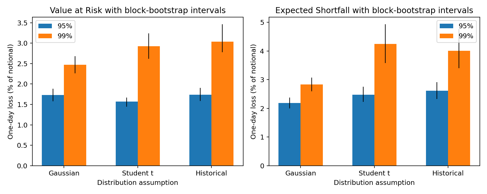
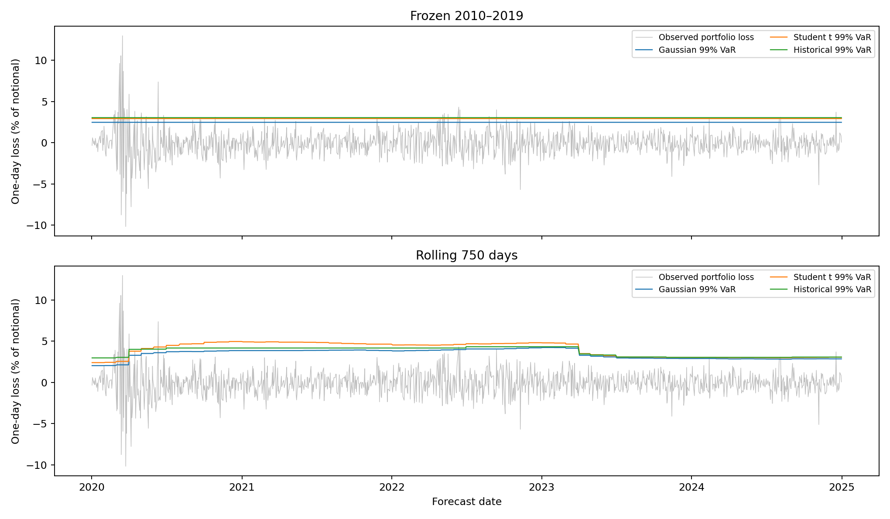

# Financial Risk Modelling Under Different Distributional Assumptions

**How sensitive are portfolio risk estimates to assumptions about the distribution of financial returns?**

A completed, reproducible portfolio project comparing Gaussian, Student's t and historical risk models. The focus is probability, statistical estimation, simulation, assumptions and validation—not trading performance or a claim of novel research.

**Main result:** the fitted 99% one-day Expected Shortfall is **2.84% under the Gaussian model and 4.25% under Student's t**. Distribution assumptions materially affect tail estimates, but heavier tails do not increase every quantile. Chronological backtesting also shows that a better unconditional distribution cannot, by itself, solve changing volatility and clustered losses.



## What is implemented

- A public academic return dataset with explicit provenance, unit conversion and input fingerprints.
- Exploratory return distributions, skewness, kurtosis, Q–Q plots, correlations and volatility clustering.
- Gaussian maximum likelihood, constrained Student t maximum likelihood and an empirical historical distribution.
- Exact one-day 95% and 99% Value at Risk (VaR) and Expected Shortfall (ES).
- 250 moving-block bootstrap samples, refitting the distributions for parameter uncertainty.
- Monte Carlo simulation with 200,000 paths at one- and ten-day horizons, including a historical block alternative and simulation standard errors.
- Sensitivity to tail thickness at fixed mean/variance and to cross-sleeve correlation assumptions.
- Frozen and rolling out-of-sample forecasts, coverage and exceedance-clustering diagnostics, yearly breakdowns and quantile scoring.
- Executed notebook, saved forecasts, mathematical verification checks and reproducible Python scripts.

## Data and portfolio

The [Kenneth French Data Library](https://mba.tuck.dartmouth.edu/pages/faculty/ken.french/Data_Library/six_portfolios.html) supplies daily returns for six US equity research portfolios formed on size and book-to-market. The project's hypothetical portfolio allocates **one sixth to each sleeve at the start of each trading day**. Returns within each sleeve are value-weighted by the provider; allocation across sleeves is equal. The weighted daily return is `r_portfolio = returns @ weights`.

These are academic research portfolios, not ETFs, bond holdings or an investable fund. We use the supplied total-return series directly, without subtracting a risk-free rate. Rebalancing costs, financing, taxes and market impact are omitted.

The parser selects only the source's **Average Value Weighted Returns -- Daily** table, converts percentage points to decimal fractions and removes missing-value markers before conversion. It does not forward-fill dates or use the separate equal-weighted table. There are **3,774 complete trading-day observations** in the selected study period, with zero missing rows removed.

- **Initial estimation:** 2010–2019, **2,516** trading days.
- **Chronological evaluation:** 2020–2024, **1,258** trading days.
- **Data snapshot:** provider file generated from the **202608 CRSP database**. Historical revisions can change future reproductions; the included snapshot and SHA-256 hash record exactly what was analyzed.

See [data provenance](data/README.md). The [provider describes a CRSP format transition](https://mba.tuck.dartmouth.edu/pages/faculty/ken.french/data_library.html) starting in 2025. Forecasts use only earlier return dates, but this is a revised historical snapshot, not a point-in-time data-vintage experiment.

## Statistical specification

Let `L = −r` be one-day loss as a fraction of portfolio notional. Positive loss means losing money. VaR is the loss distribution's alpha quantile. ES is the average of the worst `(1−alpha)` probability mass, defined through the quantile integral. At 99%, a calibrated VaR has a 1% exceedance probability; it is not a maximum possible loss.

**Gaussian:** fit mean and standard deviation by maximum likelihood, using `ddof=0`. Its loss VaR is `−mu + sigma*z_alpha`; ES is `−mu + sigma*normal_pdf(z_alpha)/(1−alpha)`.

**Student's t:** fit location, scale and degrees of freedom using constrained maximum likelihood. Bounds are `2.05 <= df <= 200`, ensuring finite variance, with broad numerical bounds on location and scale after standardization. Two starting values are tried; the best successful fit is retained, and optimization failure stops the analysis. Student t scale is not standard deviation. The training fit has **df = 3.586**, location **0.000927** and scale **0.007543**. Its loss ES uses the exact t tail formula, independently verified by numerical integration.

**Historical:** use the empirical loss distribution. VaR uses the inverse empirical CDF. ES includes a fractional threshold observation when tail probability mass is not an integer number of records. This avoids the incorrect shortcut of averaging only losses strictly greater than a discrete VaR. Historical models preserve observed asymmetry but cannot extrapolate beyond observed losses.

The Gaussian and fitted t models do not have identical means and variances; they are separate fits to the same observations. A separate sensitivity experiment holds mean and variance fixed while changing t degrees of freedom.

## Executed one-day estimates

Losses are percentages of notional. ES intervals are 95% percentile intervals from 250 circular moving-block bootstrap samples of the training series, using ten-trading-day blocks and refitting on each sample. VaR intervals are also saved in [one_day_risk.csv](reports/one_day_risk.csv).

| Distribution | Confidence | VaR | ES | ES bootstrap interval |
|---|---|---|---|---|
| Gaussian | 95% | 1.730% | 2.183% | [1.994%, 2.374%] |
| Gaussian | 99% | 2.469% | 2.837% | [2.598%, 3.074%] |
| Student t | 95% | 1.570% | 2.480% | [2.224%, 2.756%] |
| Student t | 99% | 2.922% | 4.249% | [3.576%, 4.933%] |
| Historical | 95% | 1.737% | 2.612% | [2.322%, 2.914%] |
| Historical | 99% | 3.033% | 4.010% | [3.403%, 4.764%] |

For a hypothetical $100,000 notional, 99% ES corresponds to approximately **$2,837 Gaussian**, **$4,249 Student t** and **$4,010 historical**. These are model-based averages over the worst 1% tail, not maximum losses or capital recommendations. The t point estimate is approximately **49.8% higher** than the Gaussian estimate; the difference is not presented as a formal model-selection test.

At **95%**, fitted t VaR is **1.570%**, below Gaussian VaR of **1.730%**, even though t ES is higher. Tail thickness can concentrate probability near the center while extending the extreme tail; “heavier tails always mean higher VaR” is not a valid general statement.

## Dependence and horizon sensitivity

### Correlation

Under the Gaussian model, retaining observed sleeve covariance gives 99% VaR of **2.469%**. Setting all cross-sleeve correlations to zero while retaining their variances reduces it to **1.033%**. The sleeves have substantial positive dependence, so an independence assumption exaggerates diversification. This is a counterfactual sensitivity calculation, not an alternative estimate of actual correlation.

### Tail thickness at fixed moments

Student t distributions with degrees of freedom 3, 5, 10 and 30 share the training Gaussian mean and standard deviation by setting `scale = sigma*sqrt((df−2)/df)`. Their 95% and 99% VaR/ES are saved in [tail_df_sensitivity.csv](reports/tail_df_sensitivity.csv). This separates tail shape from volatility and location changes.

### Ten-day Monte Carlo

The horizon experiment simulates **200,000 paths** under Gaussian iid, Student t iid and historical iid returns. A fourth scenario samples consecutive ten-day historical blocks. Loss is **minus the sum of daily returns**, representing constant-notional additive P&L rather than compounded buy-and-hold wealth. The sum of iid t returns is not treated as another t distribution, and no t square-root-of-time rule is assumed.

Estimated ten-day 99% ES is **8.63% Gaussian iid**, **10.17% Student t iid**, **9.57% historical iid** and **11.71% historical blocks**. The historical block result is consistent with temporal dependence affecting the tail; it does not establish future crisis severity.

Twenty simulation batches provide Monte Carlo standard errors and approximate intervals. These represent numerical simulation noise conditional on fitted distributions. They are distinct from the block-bootstrap parameter intervals. Unbounded parametric draws remain a mathematical approximation; ten-day risk is not out-of-sample backtested.

## Out-of-sample backtest

Two predeclared forecasting schemes predict the same 2020–2024 days:

1. **Frozen 2010–2019:** retain the original fitted distributions and fixed thresholds.
2. **Rolling 750 days:** fit the preceding 750 trading days at the first trading day of each month and hold forecasts fixed until the next refit. There are **60 monthly refits**, all ending before their forecast date.

The rolling scheme changes both data recency and estimation sample size. Its comparison with the frozen scheme does not isolate either effect. Both models continue to assume an unconditional distribution within each refit period; no conditional-volatility model is fitted.

At 99%, the nominal expected exceedance count is **12.58 across 1,258 days**:

| Forecast scheme | Distribution | Exceedances | Rate | Exact coverage p-value | Independence p-value |
|---|---|---|---|---|---|
| Frozen 2010–2019 | Gaussian | 52 | 4.13% | 4.585e-17 | 0.005176 |
| Frozen 2010–2019 | Historical | 28 | 2.23% | 0.0001545 | 0.1521 |
| Frozen 2010–2019 | Student t | 30 | 2.38% | 2.193e-05 | 0.1981 |
| Rolling 750 days | Gaussian | 24 | 1.91% | 0.003939 | 1.944e-06 |
| Rolling 750 days | Historical | 16 | 1.27% | 0.3188 | 0.01453 |
| Rolling 750 days | Student t | 18 | 1.43% | 0.1193 | 0.001449 |

Frozen thresholds substantially underestimate later loss frequency. Student t and historical models improve the frozen 99% exceedance rate relative to Gaussian, but still exceed the nominal rate. At 95%, frozen t coverage is worse than the other frozen models, reinforcing the need to evaluate several quantiles rather than label one distribution universally superior.

Rolling fits improve aggregate coverage. At 99%, coverage is not rejected for the rolling t and historical models at the conventional 5% level, but **failure to reject is not evidence of model validity**. All rolling models show nominal evidence of clustered exceedances under the first-order independence diagnostic, exposing limitations of monthly unconditional forecasts.



The project reports exact binomial coverage tests and rate intervals, Kupiec likelihood-ratio coverage tests, first-order Markov independence tests, average quantile loss and yearly breakdowns. Binomial and chi-squared interpretations require suitable independent-hit and asymptotic assumptions. Clustering and sparse transition counts limit nominal test reliability; these exploratory comparisons have no multiplicity correction.

ES severity is checked descriptively by comparing average realized loss and average predicted ES on VaR-exceedance days. This **is not a formal ES or joint VaR/ES backtest**, and is not regulatory validation.

## Assumptions, uncertainty and limitations

- The distribution fits are symmetric, whereas training returns have negative skew. Historical simulation retains sample skew but has limited tail support.
- Training daily volatility is **1.085%**, compared with **1.565%** in evaluation. Excess kurtosis rises from **3.95 to 10.19**, illustrating the limits of stationary pre-period estimates.
- Return and absolute-return dependence make iid simulation an assumption, not an observed fact. Ten-day bootstrap blocks preserve some local dependence but impose a fixed block length and artificial circular boundaries.
- Bootstrap intervals reflect resampling uncertainty for this training sample; they do not cover distribution misspecification, future regimes, data revisions or optimal block selection. Monte Carlo intervals reflect simulation noise only.
- The study uses one hypothetical US equity portfolio, one historical split and a revised snapshot. Results do not establish general superiority across assets, periods or portfolios.
- Equal daily allocation ignores costs; additive ten-day P&L is not compound wealth. No portfolio optimization, GARCH, skewed t, extreme-value model, stress-capital recommendation or trading strategy is implemented.
- Formal ES backtesting, repeated rolling-window sensitivities, alternative block lengths and additional portfolios remain extensions, not completed work.

## Run and reproduce

Tested using **Python 3.12.7** and the pinned core versions in `requirements.txt`. From the project root:

```bash
python3 -m venv .venv
source .venv/bin/activate
python -m pip install -r requirements.txt
python src/run_analysis.py --bootstrap 250 --paths 200000
python src/verify_results.py
jupyter lab notebooks/01_distributional_risk.ipynb
```

The pipeline resolves paths relative to the script and downloads the source CSV if absent. Included raw data allow an offline analysis after dependencies are installed. If the provider revises the file, retain the supplied snapshot for exact comparisons. For more precise intervals use, for example, `--bootstrap 1000 --paths 1000000`; paths must be divisible by 20. Outputs are overwritten. The executed notebook loads saved experiment outputs and refits the original training distributions as a worked example; rerun its cells after regenerating results.

Random seeds, weights, dates, data hash, cleaning counts, versions and run time are in [run_metadata.json](reports/run_metadata.json). Individual forecasts record the estimation window end, making chronology auditable. Verification passed checks of the data snapshot, portfolio arithmetic, **15,096 forecast rows**, **72 coverage summaries**, empirical ES examples, numerical integration of parametric ES, and analytical/Monte Carlo agreement. Floating-point results may differ slightly across platforms.

## Repository guide

```text
src/risk.py                       fitting, VaR/ES, bootstrap indices, coverage tests
src/run_analysis.py               complete experiment and figure generation
src/verify_results.py             mathematical and chronology verification
notebooks/01_distributional_risk.ipynb executed EDA and analysis walkthrough
requirements.txt                 pinned direct dependencies
METHODS.md                        formulas, units and statistical assumptions
data/raw/                        original provider snapshot
data/README.md                    provenance, source selection and units
reports/daily_returns.csv         cleaned sleeve and portfolio returns
reports/eda_summary.csv           moments and dependence diagnostics
reports/training_fit.json         initial Gaussian and Student t estimates
reports/one_day_risk.csv           exact risk estimates and bootstrap intervals
reports/bootstrap_estimates.csv   resampled risk estimates
reports/tail_df_sensitivity.csv   fixed-moment tail sensitivity
reports/correlation_sensitivity.csv covariance sensitivity
reports/monte_carlo_risk.csv       horizon estimates and simulation uncertainty
reports/forecasts.csv             date-level out-of-sample forecasts
reports/rolling_fit_parameters.csv monthly parameter estimates and windows
reports/backtest_summary.csv      coverage, clustering and severity diagnostics
reports/run_metadata.json         exact analysis configuration and data hash
reports/figures/                  verified static charts
```

## Sources and licensing

- [Kenneth French Data Library: six size/book-to-market portfolios](https://mba.tuck.dartmouth.edu/pages/faculty/ken.french/Data_Library/six_portfolios.html), source dataset and construction.
- [SciPy Student t documentation](https://docs.scipy.org/doc/scipy-1.13.1/reference/generated/scipy.stats.t.html), distribution parameterization.
- Acerbi and Tasche, [Expected Shortfall: a natural coherent alternative to Value at Risk](https://arxiv.org/abs/cond-mat/0105191), ES motivation.

Project code and documentation are MIT licensed. The source data retain the provider's applicable terms; no open data license is asserted. The project was built with AI assistance. The methods, results and limitations are documented for independent review.
